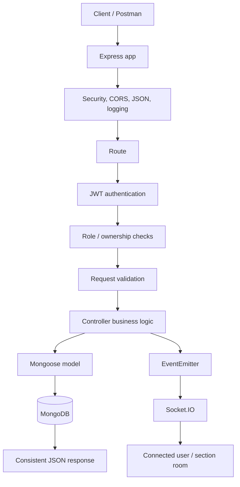

# Architecture and viva preparation

## Request lifecycle

## Main collections

- **User:** profile, email, role, password hash and token-revocation state.
- **Course:** course code, title, department and credits.
- **Section:** course/faculty references, term, capacity and active enrollment counter.
- **Enrollment:** student/section references and enrolled/dropped status.
- **Attendance:** student, section, session date, status and marking/correction metadata.
- **Announcement:** message, audience, optional course/section and creator.

## Important request flows

### Login

1. `POST /api/auth/login` receives email and password.
2. The controller retrieves the password hash and compares it with bcrypt.
3. It issues a short-lived access JWT and a refresh JWT in an HttpOnly cookie.
4. The API returns the access token and safe user profile.

### Mark attendance

1. Faculty sends `POST /api/attendance` with a section, date and student records.
2. JWT middleware confirms identity; role middleware allows faculty/admin.
3. Controller confirms faculty-section assignment and active enrollment.
4. Unique MongoDB index prevents duplicate student/section/session records.
5. EventEmitter publishes the domain event; Socket.IO notifies the section room.

### Attendance summary

1. Student calls `GET /api/attendance/summary` for their own record.
2. Faculty/admin pass `?studentId=<id>`.
3. Faculty is verified against an active enrollment in one of their own sections.
4. The aggregation is restricted to those assigned sections before grouping attendance and calculating the percentage.

## Viva questions to practise

1. Why are routes, controllers and models separated?
2. What is middleware chaining? Explain the order used by this API.
3. What is the difference between authentication and authorization?
4. Why are passwords hashed with bcrypt instead of stored as plain text?
5. What is the purpose of access and refresh tokens? How does refresh-token rotation work?
6. Why is `select: false` used for password and refresh-token hashes?
7. What does a compound unique index prevent in the Enrollment and Attendance models?
8. Explain the `$match`, `$group`, `$lookup` and `$project` stages in one attendance aggregation.
9. Why is EventEmitter used in addition to Socket.IO?
10. How does a Socket.IO client authenticate and join only its authorized rooms?
11. What response should a missing token produce? What about a valid token with the wrong role?
12. Walk through one request from route → middleware → controller → model → MongoDB → response.

Each member should prepare one real endpoint they implemented or materially modified and be able to explain its code without reading a generated answer.
